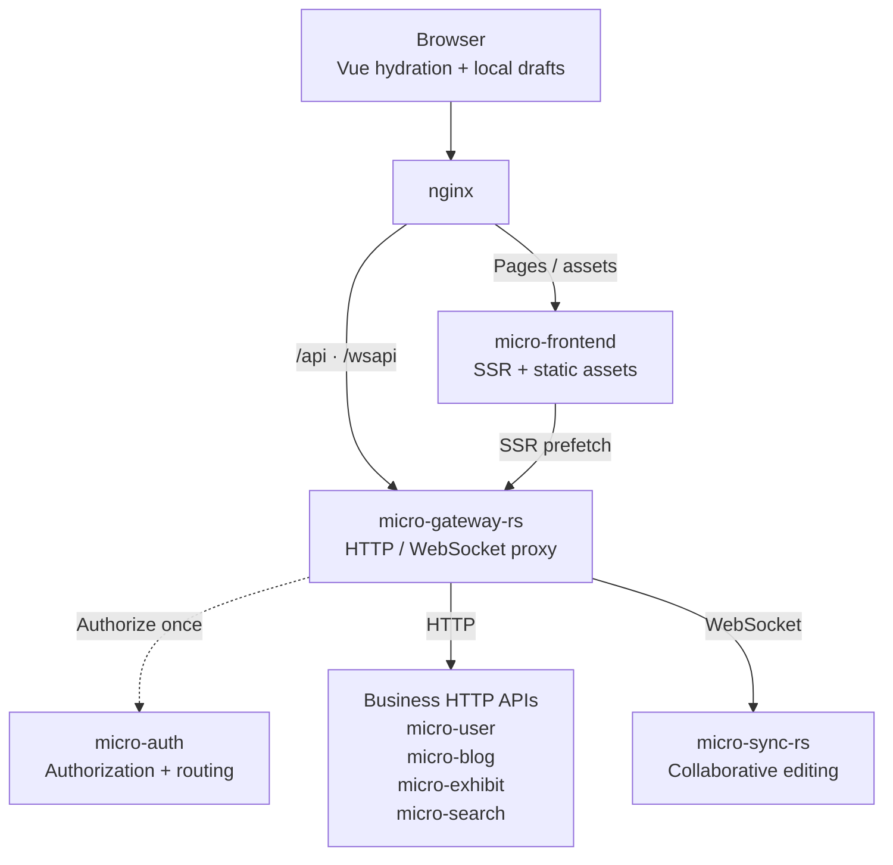
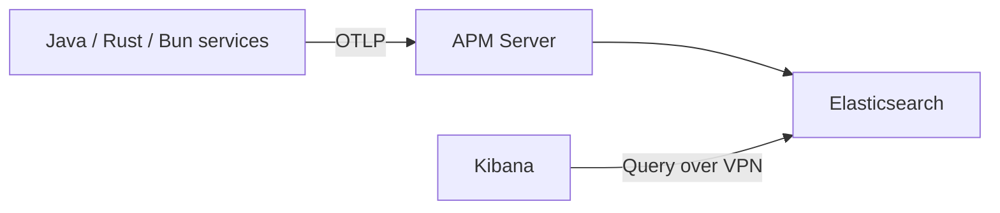
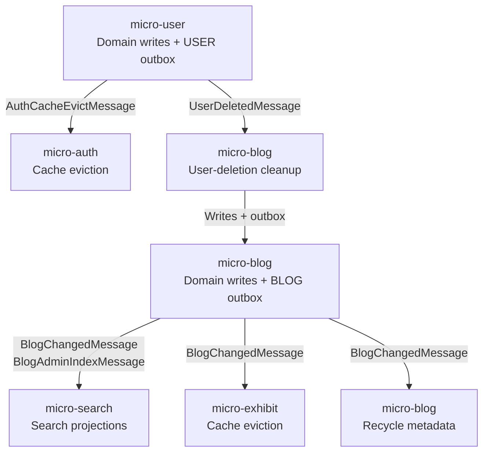

# Megalith Micro

[](https://www.graalvm.org/)
[](https://spring.io/projects/spring-boot)
[](https://www.rust-lang.org/)
[](https://bun.sh/)
[](LICENSE)

Megalith Micro is a cloud-native blogging and content-management platform with public publishing,
administration, full-text search, and collaborative editing. This monorepo brings together Java
business services, a Rust gateway and collaboration service, and a Vue SSR frontend.

> Inspired by Zhiming Zhou's _The Phoenix Architecture_ (《凤凰架构》), the project explores
> software architecture through a working application, evolving from a monolith through
> distributed systems and microservices to a cloud-native deployment.

Every application is delivered as a **single native executable in its own OCI image**. The five
Spring Boot services compile ahead of time with GraalVM Native Image, the Rust services build as
release binaries, and Bun packages the frontend server and assets into a standalone executable.
Production application images contain the executable and minimal OS runtime files, without a
separate JVM, JRE, Bun installation, build toolchain, or source tree.

| Applications | Technology | Production artifact |
| --- | --- | --- |
| `micro-auth`, `micro-user`, `micro-blog`, `micro-exhibit`, `micro-search` | Java 25, Spring Boot 4.1.2, GraalVM 25.5 Innovation | GraalVM Native Image executable |
| `micro-gateway-rs`, `micro-sync-rs` | Rust 2024, Tokio, Axum | Rust release executable |
| `micro-frontend` | Bun 1.4, Vue 3.5, Vite 8, SSR | Bun standalone executable with embedded assets |

MariaDB, Redis, RabbitMQ, Elasticsearch, and the monitoring infrastructure use their standard
container images.

## Architecture

The overview shows request routing. Data ownership, event delivery, and monitoring are described
separately below so each view remains readable on GitHub.



Public application traffic enters through nginx. The Rust gateway proxies HTTP and WebSocket requests,
calls `micro-auth` once for authorization and route resolution, and passes a trusted principal to
the target service. Business services use that principal for identity and permission checks.

### Data and service dependencies

| Resource | Owners / clients | Responsibility |
| --- | --- | --- |
| MariaDB | `micro-user`, `micro-blog` | User and blog domain data, working drafts, immutable revisions, and transactional outbox rows |
| Redis | Auth, blog, exhibit, search, and sync services | Tokens and caches, blog runtime state, existence indexes, distributed task locks, and collaboration Streams/state |
| RabbitMQ | User/blog outbox publishers and event consumers | Confirmed domain-event delivery and cache-invalidation broadcasts |
| Elasticsearch | `micro-search`, APM Server | Public/admin/revision search projections and observability storage |

`micro-exhibit` reads public articles and recommendations from `micro-search`, gets author details
from `micro-user`, and calls `micro-blog` for visit counting and existence-index scans. `micro-blog`
uses `micro-search` for search/list projections and batched read-count updates. Search maintenance
reads authoritative snapshots from `micro-blog`. Auth cache misses fetch user/permission snapshots
from `micro-user`; collaboration tickets also use fresh authorization reads.

### Monitoring



All application services export correlated OpenTelemetry traces, metrics, and logs. Browser traffic
is observed at the gateway; the browser does not export directly to the private APM endpoint.

### Remote administration: WireGuard over WSS

The platform uses a private network for remote monitoring and administration. Kibana runs in
Docker on a developer workstation in mainland China and connects to Elasticsearch on the Canadian
server through WireGuard. Elasticsearch is accessible over the VPN without exposing its API to
the public Internet.

The project uses [wstunnel](https://github.com/erebe/wstunnel/blob/v10.7.1/README.md#wireguard) to
address Great Firewall (GFW) interference with cross-border WireGuard UDP connectivity. A
Dockerized client and server carry WireGuard's encrypted UDP packets over a TLS-protected
WebSocket connection (WSS), allowing the public connection to use TCP. WireGuard provides VPN
addressing, peer authentication, and end-to-end encryption; wstunnel provides the transport across
the filtered network. TCP retransmissions can add latency when packets are lost.

The WSS connection terminates at a dedicated wstunnel listener on TCP `8443`, independently of nginx
and the application gateway. The client verifies the server's TLS certificate, and the server
requires a shared access token and restricts forwarding to its local WireGuard listener. Only the
private subnet is routed through the VPN, where Kibana reaches Elasticsearch at
`https://172.16.0.1:9200`.

### Message and outbox topology

User and blog changes propagate through a transactional outbox and RabbitMQ. Each event has
dedicated consumers for authorization caches, search indexing, presentation caches, or related
content cleanup.



Event arrows represent outbox publication and RabbitMQ delivery, with publisher confirms at each
publication boundary. The durable fanout exchanges and consumer queues are:

| Event | Exchange | Queues |
| --- | --- | --- |
| `AuthCacheEvictMessage` | `user.auth.menu.change.fanout.exchange` | `user.auth.menu.change.queue.auth` |
| `UserDeletedMessage` | `user.deleted.fanout.exchange` | `user.deleted.queue.blog` |
| `BlogChangedMessage` | `blog.change.fanout.exchange` | `blog.change.queue.es`, `blog.change.queue.cache`, `blog.change.queue.recycle` |
| `BlogAdminIndexMessage` | `blog.admin.change.fanout.exchange` | `blog.admin.change.queue.es` |

| Event | Producer | Consumer | Responsibility |
| --- | --- | --- | --- |
| `AuthCacheEvictMessage` | `micro-user` | `micro-auth` | Invalidate authorization, menu, and route caches |
| `UserDeletedMessage` | `micro-user` | `micro-blog` | Delete the user's blogs and emit the corresponding blog events |
| `BlogChangedMessage` | `micro-blog` | `micro-search` | Update the search index |
| `BlogAdminIndexMessage` | `micro-blog` | `micro-search` | Update admin blog and immutable revision projections |
| `BlogChangedMessage` | `micro-blog` | `micro-exhibit` | Invalidate presentation caches |
| `BlogChangedMessage` | `micro-blog` | `micro-blog` | Retain recycle-bin metadata for operator removals |

Domain writes and outbox entries commit in the same database transaction. The publisher removes
an outbox entry after RabbitMQ confirms publication and retries failed publications with bounded
backoff. Consumers use manual acknowledgements and confirmed retry publication; messages that
exhaust their delayed retries are retained in dead-letter queues for investigation and recovery.

### Search and caching

Elasticsearch owns the public blog read model and the administration list projections. Public list,
detail, sensitive-content masking data, and recommendations are served from `blog_search`; admin
lists use `blog_admin_search`, and version search uses `blog_revision_search`. Editing and version
diff payloads are read from MariaDB so index lag cannot affect the editor. Content events carry
self-contained administration snapshots and monotonic projection revisions so consumers can reject
out-of-order updates without reading potentially stale index state. The Elasticsearch repositories
create any missing physical index and alias during startup; the maintenance rebuild replaces all
three aliases together after both search queues are quiescent. `total` counts all article identities;
`publishedTotal` counts only identities with a published revision. Public and administration rebuilds
validate against those respective counts. Article visits update MariaDB counters;
cumulative counts are synchronized to Elasticsearch in batches through idempotent updates.

Presentation reads use Caffeine as an in-process L1 cache and Redis as a shared L2 cache. Versioned
cache keys identify individual results, and a key registry tracks cached pages for invalidation.
Blog events invalidate the affected entries across service replicas. See the
[cache module](cache/README.md) for key generation, locking, and distributed eviction.

### Stateless collaboration

`micro-sync-rs` uses YRS CRDT for collaborative documents and Redis for coordination across
replicas. Document and awareness updates flow through shared Redis Streams to connected clients.
Snapshots, presence, connection leases, and compaction state also live in Redis, allowing any
replica to serve any room without sticky sessions or a dedicated room owner.

## Applications and Modules

### Deployable Applications

| Application | Responsibility |
| --- | --- |
| `micro-gateway-rs` | Streaming HTTP/WebSocket proxy, origin checks, centralized authorization entry point, and dynamic routing |
| `micro-auth` | JWT, login, route authorization, and authorization snapshot caches |
| `micro-user` | Users, roles, menus, authorities, and data permissions |
| `micro-blog` | Blog content, recycle bin, domain events, and user-deletion cleanup |
| `micro-exhibit` | Content presentation, visit statistics, and presentation caches |
| `micro-search` | Elasticsearch full-text search and index event consumption |
| `micro-sync-rs` | Stateless real-time collaboration backed by YRS CRDT and Redis |
| `micro-frontend` | Vue 3 SSR, server prefetch, client hydration, and embedded static assets |

### Shared Java Modules

| Module | Responsibility |
| --- | --- |
| `api-auth`, `api-user`, `api-blog`, `api-search` | Typed HTTP contracts and RPC records |
| `cache` | Caffeine L1 + Redis L2 caching, exact eviction, and replica-wide invalidation |
| `common-contract` | Result, error, paging, validation, security, and message contracts |
| `common-rpc` | HTTP clients, principal propagation, and external service adapters |
| `common-arch` | The shared ArchUnit rules every Java application runs in its layering test |
| `common-web`, `common-auth-web` | Functional WebMVC, error handling, validation, and trusted principal resolution |
| `common-observability` | OpenTelemetry integration and GraalVM runtime hints |
| `common-messaging`, `common-outbox` | Consumer retries, dead-letter queues, and the transactional outbox |
| `common-scheduling`, `common-export` | Distributed scheduler locks and export utilities |

Shared infrastructure modules use dedicated roots under `wiki.chiu.micro.common`, so
`common-messaging`, `common-scheduling`, and `common-outbox` own `wiki.chiu.micro.common.messaging`,
`wiki.chiu.micro.common.scheduling`, and `wiki.chiu.micro.common.outbox` respectively. `common-outbox`
follows the same `domain`, `application`, `adapter.in.*`, `adapter.out.*`, and `config` layering as
the applications. `common-auth-web` uses `wiki.chiu.micro.common.auth.web`. `common-contract`
groups its contracts directly under `wiki.chiu.micro.common` by kind, one package per kind: `result`
for response envelopes, `error` for error codes, `exception` for the runtime exception types that
carry them, `message` for outbox payloads, `model` for cross-service projections, `enums` for
shared domain enumerations, `constant` for shared constants, `page` for the paging envelope,
`security` for the trusted principal and internal headers, and `validation` for reusable request
validators. `common-arch` owns
`wiki.chiu.micro.common.arch` and holds the ArchUnit rules that give every application the same
layer rules instead of one hand-written rule set per service.

### Java application boundaries

The five Java applications use the same ports-and-adapters layout for their core code:

| Package | Responsibility |
| --- | --- |
| `domain` | Business entities and domain state without delivery or infrastructure dependencies |
| `application.model` | Use-case-specific inputs, outputs, pages, and event context |
| `application.port.in` | Use cases exposed to HTTP, messaging, and schedulers |
| `application.port.out` | Persistence, remote service, Redis, search, and object-storage capabilities required by use cases |
| `application.service` | Use-case orchestration; depends on domain types and ports rather than adapters |
| `adapter.in.*` | Functional WebMVC handlers/routes, the Spring Security filter chain, RabbitMQ consumers, and schedulers |
| `adapter.out.*` | HTTP clients, Spring Data repositories and JPA entities, transactional writers, Redis, Elasticsearch, metrics, object storage, and token codecs |
| `config` | Spring wiring, configuration properties, RabbitMQ topology, AOT hints, and application configuration |

`api-<service>` shares its application's namespace (`wiki.chiu.micro.<service>.api`) but is a
separate contract module: `application` must not depend on it, and only adapters bind it.

`domain` and `application` are framework-free: no Spring, Hibernate, Redisson, Jackson, micrometer,
or Elasticsearch type appears there, and neither layer names another service's wire contract.
Adapters may use those frameworks but never reach into `config` or across to the opposite adapter
direction, and `config` is the only place that knows every implementation: application services
carry no Spring annotations and are declared as beans there.

Messaging input adapters translate shared queue envelopes into application commands before invoking
use cases. Domain models do not construct or consume aggregate transport snapshots; conversion lives
in adapter mappers. Shared business enums, value objects, and application read projections remain
available through `common-contract`.

Input adapters call ports, and application services call output ports. Spring Data, Redisson,
remote HTTP contracts, and storage clients stay behind output adapters. Application services
prepare inputs and coordinate use cases; persistence adapters own the short transactions that
commit domain writes and outbox entries. An export or download use case returns the rows to export,
and the adapter that offers the download renders the script with `common-export` and writes the
response. A paged use case returns the core `application.model.Page`, and the adapter that renders
the response builds the shared `common-contract` `PageAdapter` envelope from it. `common-arch` runs
the shared dependency, transaction, and package-layout rules for every application, and a service
adds only the rules it needs on top. Transaction checks identify persistence writers by their
method/class annotations, follow persistence helpers and method references, and reject Spring Data
repository reads without relying on a `Wrapper` class-name suffix. Read-only transactions and reads
outside write transactions remain supported.

### Rust application boundaries

The collaboration service separates protocol, application, and infrastructure concerns. The
gateway organizes its code around authentication, forwarding policies, and HTTP/WebSocket delivery:

| Service area | Responsibility |
| --- | --- |
| `micro-sync-rs/domain` | Yjs protocol handling and collaboration event/state models |
| `micro-sync-rs/application` | Room, relay, lease, presence, and compaction orchestration through store ports |
| `micro-sync-rs/adapter/inbound` | Axum WebSocket and health delivery |
| `micro-sync-rs/adapter/outbound/redis` | Redis Streams, snapshots, presence, workers, connections, and external Lua scripts |
| `micro-gateway-rs/client` | Pooled downstream HTTP and the bounded auth control-plane client |
| `micro-gateway-rs/proxy` | Authorized-route models and no-I/O origin, header, URI, and WebSocket-frame policies |
| `micro-gateway-rs/handler`, `middleware` | Axum HTTP/WebSocket delivery and single-pass authorization flow |

`micro-sync-rs` application code depends on store traits and application-level errors; Redis
connections, keys, and Stream IDs are encapsulated by the outbound adapter. The gateway keeps
no-I/O forwarding policies separate from the clients, handlers, and middleware that perform
network operations.

## Frontend

`micro-frontend` serves the public site and administration interface using Vue 3 and Bun. It is
built and deployed independently of the Java and Rust services. Dependency versions are declared
directly in `micro-frontend/package.json` and resolved into the single root `bun.lock`.

Public and administration routes are rendered on the Bun server and hydrated by Vue in the
browser. Each SSR request creates isolated Vue Router, Pinia, i18n, head-management, and HTTP
state. The server prefetches route data through `micro-gateway-rs`, and the browser reuses it
during hydration. Browser API and WebSocket requests reach the gateway directly through nginx.

Authentication uses HttpOnly cookies. The SSR server forwards request cookies to the gateway and
propagates refreshed `Set-Cookie` headers. Access and refresh tokens stay outside browser
JavaScript and client-side storage.

### Editor collaboration and drafts

The administration editor combines Yjs real-time collaboration with local and server draft
persistence. Document changes synchronize with `micro-sync-rs` over WebSocket and merge through the
CRDT. IndexedDB buffers offline changes, while `m_blog_draft` stores the current server-side working
copy. Autosaves accept incomplete titles, descriptions, and content; explicit version saves and
publication require all three fields to be nonblank. Version saves create immutable rows in
`m_blog_revision`; publishing moves the blog's published revision pointer without modifying history.
The version page compares the selected version with its immediate predecessor. The application layer
prepares the current identity,
working draft, published revision, and next revision number before a short persistence transaction;
conditional revision checks reject competing saves without querying inside the write transaction.

Collaboration and draft storage run in the browser. Each new editor creates an independent server draft in the browser and records its ID in the URL.
Rooms and local draft keys include an article's `collaborationEpoch`. Publishing (including restoring a
historical publication), deleting a working draft, or recovering a deleted article starts a new epoch;
ordinary draft saves and status changes keep it. The blog service initializes each room through the
sync service before signing a ticket. Redis atomically installs one YRS seed, including empty documents;
browsers never independently seed the same room.

Collaboration tickets use authoritative user/role reads at the existing single route-authorization
boundary. Their authorization expires within 60 seconds of that check, and the gateway terminates
connections at that absolute deadline, including downstream connection time. Replaying a ticket cannot
extend its lifetime. Clients renew and reconnect 15 seconds before expiry; denied authorization pauses
editing while retaining local content. Epoch changes preserve the old content as read-only recovery
copies and reload the current editor state. Old-epoch HTTP saves are rejected with 409.
The editor supports online collaboration when local storage is unavailable. Published blogs open a
newer active draft automatically; older drafts are retained as read-only history and never override
the published version. A newer active draft is based on the current published revision and has a
later saved timestamp.

### Runtime and configuration

Vite builds the client and SSR bundles, then Bun compiles the server, runtime, and assets into
`micro-frontend/dist/bin/megalith-frontend`. The service exposes `/actuator/health`, performs
graceful shutdown, and exports correlated OpenTelemetry traces, metrics, and logs.

| Variable | Default / production value | Purpose |
| --- | --- | --- |
| `PORT` | `1919` | Bun SSR listen port |
| `SSR_API_BASE_URL` | `http://127.0.0.1:8088` / `http://micro-gateway-rs:8088` | Gateway used for SSR prefetch |
| `APP_ORIGIN` | Incoming request origin | Origin forwarded for cookie-authenticated requests |
| `OTEL_SERVICE_VERSION` | Package version / deployed Git SHA | Frontend release identifier |
| `OTEL_EXPORTER_OTLP_ENDPOINT` | `http://127.0.0.1:8200` / `http://apm-server:8200` | Base OTLP endpoint for traces, metrics, and logs |
| `LOG_LEVEL` | `info` | Console and OTLP application log threshold |

See the [SSR architecture](micro-frontend/docs/ssr-architecture.md) for request flow,
authentication, caching, observability, failure behavior, and deployment details.

## Core Design

- **Single-pass authorization:** the gateway calls `POST /inner/auth/route` once to resolve both
  the target service and trusted principal. Business services use the gateway-injected
  `X-Megalith-Principal` as their identity source.
- **Two-level caching:** `@Cache` uses explicit versioned namespaces and canonical argument hashes,
  with Caffeine L1 and Redis L2 storage. Reads and exact eviction share distributed key locks;
  invalidations are broadcast to every replica.
- **Short write transactions:** services perform reads, validation, and input preparation outside
  a transaction. Persistence adapters commit writes and the matching outbox entries in a short
  transaction, with ArchUnit enforcing ownership boundaries.
- **Reliable domain events:** user and blog changes commit to a MariaDB transactional outbox before
  confirmed publication through RabbitMQ. Independent consumers handle cache eviction, search
  indexing, and related content cleanup.
- **Stateless collaboration:** `micro-sync-rs` uses YRS CRDT and shared Redis for session streams,
  snapshots, and presence, allowing connections to be distributed across replicas.
- **Native resource packaging:** runtime hints cover reflective Java APIs and serialization, and
  Redis Lua resources are bundled into Java and Rust executables.
- **Correlated observability:** Java, Rust, and Bun services propagate trace context and export
  OpenTelemetry traces, metrics, and logs to the monitoring infrastructure.

### Collaboration compatibility and search rebuilds

Changes to ticket payloads, authorization deadlines, room names, or draft-write contracts require
a coordinated maintenance window when old and new replicas are incompatible:

1. Ask active editors to retain/export uncommitted work. Stop new traffic and close old gateway
   WebSockets. Stop all blog writers, including user-deletion consumers, before replacing services.
2. The one-time `collaboration_epoch` startup migration has been retired after rollout. Existing
   databases must already contain the non-null UUID column; startup no longer alters or backfills it.
   A fresh database is created normally by Hibernate, and the application assigns epochs to new articles.
   Do not clear Redis or IndexedDB: room names isolate collaboration epochs; legacy local drafts remain available as recovery
   copies and old Redis rooms expire under their existing retention policy.
3. Deploy auth, blog, sync, gateway, and frontend together. The deployment workflow sets
   `MEGALITH_BLOG_SYNC_URL=http://micro-sync-rs:8089` for blog containers; set the same value for manual deployments. The sync initialization route
   `/inner/rooms/{roomId}/initialize` is internal-only and must never be added to external gateway routes.
   Keep service clocks synchronized, as with JWT validation.
4. Verify independent new drafts, cross-replica collaboration, historical restoration, 409 on old-epoch
   writes, automatic renewal, and forced closure of a raw client at ticket expiry before restoring traffic.

For a search rebuild, set `megalith.blog.maintenance.read-only=true` on **every** blog replica and wait
for old writable replicas and in-flight writes to finish. Drain the BLOG outbox (including paused rows)
and both search queues, retries, and dead-letter queues; then stop all search consumers using search
maintenance mode. Confirm source status and queue checks pass before calling the rebuild endpoint.
Creation, draft/version saves, publication, draft deletion, status changes, deletion, and recovery all
reject writes in maintenance mode. Visit counting remains available, and the existing statistics lock
excludes concurrent read-count synchronization. A failed rebuild retains the old aliases; inspect
ambiguous alias-switch outcomes before retrying. Restore consumers and writable replicas only after
validating all three indexes, including a dataset containing unpublished drafts.

## Build

### Requirements

- GraalVM 25.5.5.0.3 innovation release for JDK 25 using the HotSpot JVM, not the
  Espresso JVM
- Gradle 9.9.0 through the included Wrapper
- Rust stable with 2024 edition support
- Bun 1.4.3 for workspace development and CI; the frontend Docker builder currently uses 1.4.4
- Docker for OCI image builds

Example on macOS:

```bash
export JAVA_HOME=/Library/Java/JavaVirtualMachines/graalvm-25.5.5.0.3+1.1/Contents/Home
```

### Checks and Tests

```bash
./gradlew build
# Docker is required for these separate Testcontainers suites.
./gradlew :micro-user:integrationTest :micro-blog:integrationTest \
  :micro-exhibit:integrationTest :micro-search:integrationTest :cache:integrationTest
cargo fmt --all -- --check
cargo clippy --workspace --all-targets -- -D warnings
cargo test --workspace
# Requires a Redis 8 instance on localhost.
MICRO_SYNC_TEST_REDIS_URL=redis://127.0.0.1:6379/ \
  cargo test -p micro-sync-rs redis_store_round_trip_when_configured -- --ignored
bun install --frozen-lockfile
bun run frontend:check
```

`./gradlew build` covers unit tests, ArchUnit boundaries, and Spring test AOT processing.
The separate `integrationTest` tasks above are not attached to `build` or `check`.
The blog startup integration test boots the real application with MariaDB, Redis, and RabbitMQ, then
checks health, draft creation, collaboration initialization, and outbound trace propagation. It runs
in the Java CI quality gate before publishing images. To smoke-test the actual Native Image as well:

```bash
./gradlew :micro-blog:nativeCompile
MICRO_BLOG_NATIVE_EXECUTABLE="$PWD/micro-blog/build/native/nativeCompile/micro-blog" \
  ./gradlew :micro-blog:integrationTest --tests '*BlogApplicationStartupIntegrationTest'
```

Rust checks cover formatting, linting, and service behavior; frontend checks cover linting, types,
tests, and SSR builds. The frontend uses `tsrs` for all three TypeScript projects and the Vize
content mapper for Vue scripts and templates. A type-check smoke test verifies that invalid
scripts, templates, props, emits, component consumers, and Bun sources fail with diagnostics.
Oxlint uses the same locked version locally and in CI, with `tsrs-lint` enforcing Promise-handling
rules in TypeScript files. Vue files retain syntax lint and separate type checks; Oxlint's
type-aware backend does not currently cover their scripts.
See the [frontend type-checking guide](micro-frontend/docs/type-checking.md) for commands and upgrades.

### Native Executables

```bash
# Java / GraalVM Native Image
./gradlew :micro-auth:nativeCompile

# Rust
cargo build --workspace --release

# Bun workspace / frontend
bun run frontend:build
```

Java artifacts are written to each module's `build/native/nativeCompile/` directory. Rust artifacts
are written to `target/release/`; the frontend executable is written to
`micro-frontend/dist/bin/megalith-frontend`.

### Application Images

Spring Boot Buildpacks build and publish each Java service as a GraalVM Native Image container. Set
`DOCKER_USERNAME` and `DOCKER_PWD` before running the task:

```bash
./gradlew :micro-auth:bootBuildImage
```

The Rust and Bun services use multi-stage Dockerfiles:

```bash
docker build -t megalith-micro-gateway-rs:latest -f micro-gateway-rs/Dockerfile .
docker build -t megalith-micro-sync-rs:latest -f micro-sync-rs/Dockerfile .
docker build -t mingchiuli/megalith-frontend:latest -f micro-frontend/Dockerfile .
```

CI runs the checks for each language, including Java AOT validation and Redis-backed collaboration
tests, before building release images. Services are published independently and deployed in
dependency order, with the frontend following the gateway.

### Development

Run individual services with their development toolchains:

```bash
./gradlew :micro-auth:bootRun
cargo run -p micro-gateway-rs
bun run frontend:dev
```

The frontend development server listens on `http://127.0.0.1:1919` and expects the gateway at
`http://127.0.0.1:8088`. For local HTTP login, run `micro-auth` with
`MEGALITH_AUTH_COOKIE_SECURE=false`.

A complete local deployment also requires MariaDB, Redis, RabbitMQ, and Elasticsearch. Backend
connection, port, and OpenTelemetry defaults are defined in each service's `application.yml`;
frontend settings are listed above.

## License

This project is licensed under the [Apache License 2.0](LICENSE).
